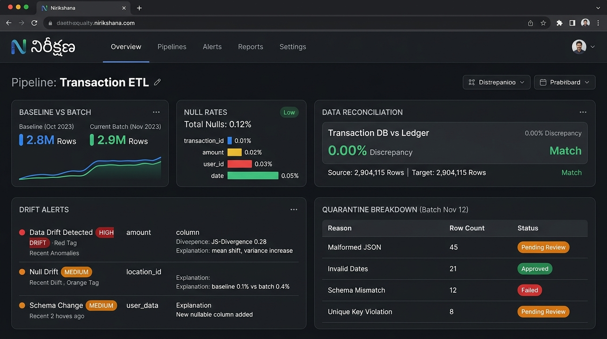

# నిరీక్షణ (Nirikshana) — Batch Profile Drift Detector & Data Quality Pipeline



**Nirikshana (నిరీక్షణ - Telugu for *Vigilant Observation*)** is a lightweight, reliable Python data pipeline. It profiles incoming data batches, detects data drift against a baseline, flags explainable alerts, and safely routes bad rows into a quarantine table.

---

## What This Pipeline Does (In Plain English)

1. **Sets a Baseline:** Ingests a clean batch of data and calculates baseline stats (null rates, min/max/mean, distinct counts, row counts, and timestamps).
2. **Checks Later Batches:** Compares every incoming batch against the baseline to calculate differences.
3. **Fires Clear, Explainable Alerts:** When numbers drift, it explains *exactly* what happened in plain English rather than just failing.
4. **Quarantines Bad Records:** Catches malformed values, missing fields, duplicate IDs, and invalid reference keys. It saves them to a `quarantine` table with the exact reason why they were rejected.
5. **Prevents Duplicate Data (Idempotent):** If you rerun the exact same batch, it replaces previous run records cleanly without duplicating rows.
6. **Reconciles Everything (Zero Data Loss):** Verifies that `Input Rows = Target Loaded Rows + Quarantined Rows` with zero discrepancy.

---

## Explainable Alerts

Alerts are human-readable with baseline numbers, current numbers, deltas, and plain explanations:

```text
ALERT [null_rate] column=customer_id severity=HIGH
  baseline=0.01  current=0.28  delta=+0.27  threshold=0.10
  message: "Null rate increased 27 points vs baseline"

ALERT [mean_shift] column=amount severity=HIGH
  baseline=123.75  current=345.75  delta=+222.00  threshold=24.75
  message: "Mean for amount increased by 179% vs baseline"

ALERT [freshness_lag] column=timestamp severity=HIGH
  baseline=0.00  current=30.00  delta=+30.00  threshold=3.00
  message: "Data is out-of-order or stale by 30.0 days vs baseline timestamp"
```

---

## Quickstart

### 1. Install Dependencies
```bash
pip install -r requirements.txt
```

### 2. Launch the Web Dashboard
```bash
python app.py
```
Open **`http://localhost:8000`** in your browser. From the dashboard you can:
- Select and run batches
- Toggle baseline vs drift comparison
- View real-time explainable alerts
- Inspect quarantined records and rejection reasons
- View the reconciliation table

---

## Command Line Usage

### Step 1: Generate Demo Data Batches
```bash
python pipeline.py --generate-samples
```
This generates 7 sample files in the `data/` directory (baseline, normal, null drift, amount drift, stale timestamp, corrupted records, and empty batch).

### Step 2: Set the Baseline Profile
```bash
python pipeline.py --input data/batch_001_baseline.csv --run-id run_001 --set-baseline
```

### Step 3: Run a Normal Batch
```bash
python pipeline.py --input data/batch_002_normal.csv --run-id run_002
```

### Step 4: Run a Drifted Batch (See Alerts)
```bash
python pipeline.py --input data/batch_003_drift_nulls.csv --run-id run_003
```

### Step 5: Run Edge Cases & Quarantine
```bash
python pipeline.py --input data/batch_006_corrupted.csv --run-id run_006
```

### Step 6: Verify Reconciliation
```bash
python pipeline.py --reconcile
```

---

## Performance Benchmark (100,000 Rows)

Run the included benchmark script:
```bash
python benchmark_100k.py 100000
```
- **Generation:** 100,000 rows in 1.14s (87,572 rows/sec)
- **Pipeline Execution:** 100,000 rows in 2.55s (39,172 rows/sec)
- **Reconciliation:** 100% matched (Diff = 0)

---

## Running Automated Tests

Run the full test suite with `pytest`:
```bash
pytest -v
```

Tests include:
- Happy path (clean batch)
- Empty batch
- Malformed record (invalid numbers/timestamps)
- Duplicate key (intra-batch and database cross-batch)
- Nulls in required fields
- Invalid foreign key reference
- Stale / out-of-order timestamp data
- Schema change (missing required column)
- Idempotency test (rerunning same batch produces identical rows)
- Reconciliation integrity check
- Human-readable alert formatting check

---

## Project Structure

```text
├── app.py                   # Nirikshana Web GUI application (FastAPI)
├── pipeline.py              # Main CLI pipeline orchestrator
├── benchmark_100k.py        # 100k row performance benchmark
├── config.yaml              # Thresholds and schema settings
├── requirements.txt         # Project dependencies
├── DATA_DICTIONARY.md       # Full table and column specs
├── DESIGN_NOTES.md          # Architecture and design trade-offs
├── RECONCILIATION_REPORT.md # Reconciliation queries and integrity math
├── assets/
│   └── nirikshana_gui.jpg   # Dashboard preview image
├── src/
│   ├── alert_engine.py      # Threshold evaluation and alert formatting
│   ├── comparator.py        # Delta calculation between batches
│   ├── db.py                # SQLite schema setup and idempotency cleanup
│   ├── generator.py         # Seeded synthetic data generator
│   ├── profiler.py          # Column and batch statistics
│   ├── reconciler.py        # Verification of zero data loss
│   └── validator.py         # Schema, key, and quarantine validation
└── tests/
    └── test_pipeline.py     # 11 unit and edge case tests
```
